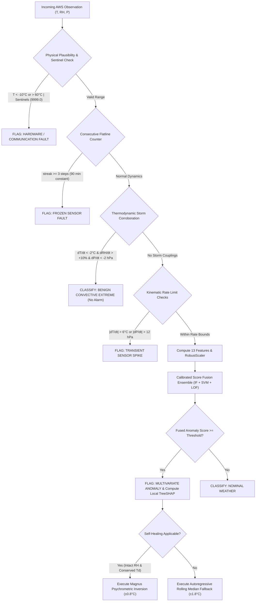

# Intelligent Anomaly Detection & Self-Healing for Automatic Weather Stations

[](https://www.python.org/)
[](https://fastapi.tiangolo.com/)
[](https://dotnet.microsoft.com/en-us/apps/maui)
[](https://scikit-learn.org/)
[](https://github.com/shap/shap)
[](#run-automated-test-suite)
[-orange.svg)](#project-overview)

An end-to-end meteorological quality control, anomaly detection, explainability, and real-time self-healing engine engineered for remote **Automatic Weather Stations (ISRO AWS Station `ISRO0119_15F077`, VIT Vellore, Tamil Nadu)**.

The system monitors authentic single-level surface meteorological channels:
* **Air Temperature (°C)** — *Thermistor*
* **Relative Humidity (%)** — *Capacitive Hygrometer*
* **Atmospheric Pressure (hPa)** — *Piezoresistive Barometer*
* **Battery Voltage (V)**, **Wind Speed (m/s)**, and **Rainfall (mm)**

---

## Table of Contents

- [Project Overview](#project-overview)
- [Key Scientific & Engineering Innovations](#key-scientific--engineering-innovations)
- [Empirical Benchmarks & Fault-Injection Results](#empirical-benchmarks--fault-injection-results)
- [Decision Hierarchy: Extreme Weather vs. Hardware Faults](#decision-hierarchy-extreme-weather-vs-hardware-faults)
- [System Architecture & Full-Stack Platform](#system-architecture--full-stack-platform)
- [Repository Structure](#repository-structure)
- [Execution & Quickstart Guide](#execution--quickstart-guide)
- [REST API Specification](#rest-api-specification)
- [PowerPoint Presentation Deck](#powerpoint-presentation-deck)
- [Audit & Verification Documentation](#audit--verification-documentation)

---

## Project Overview

Automatic Weather Stations (AWS) deployed in remote, harsh environments continuously transmit observation packets every 30 minutes. Traditional quality control relies on static physical bounds, which fail to detect:
1. **Frozen Sensors (Flatlines):** Firmware hangs transmitting identical floating-point values for hours without violating min/max limits.
2. **Gradual Calibration Drift:** Thermistor degradation accumulating subtle offsets ($+0.10^\circ\text{C}$/step) imperceptible to single-point checks.
3. **The False-Alarm Trap:** Genuine weather extremes (monsoon convective thunderstorm downbursts, severe summer heatwaves) trigger false alarms in standard machine learning models during the exact storms meteorologists need to record.

This project delivers a **physics-guided, multi-model ensemble detection engine** paired with **TreeSHAP explainability**, **closed-form thermodynamic self-healing**, and a **high-throughput FastAPI + .NET 10 MAUI production dashboard**.

---

## Key Scientific & Engineering Innovations

### 1. 13-Dimensional Domain & Temporal Feature Space
Rather than feeding raw values directly into ML algorithms, the pipeline dynamically computes 13 engineered features:
* **Base Surface Channels (3):** Temperature ($T$), Relative Humidity ($RH$), Barometric Pressure ($P$).
* **Psychrometric Thermodynamic Features (2):**
  * *Magnus-Tetens Dew Point ($T_d$):*
    $$\gamma(T, RH) = \frac{17.27 \cdot T}{237.7 + T} + \ln\left(\frac{RH}{100}\right), \quad T_d = \frac{237.7 \cdot \gamma}{17.27 - \gamma}$$
  * *Vapor Pressure Deficit (Dew Point Depression):* $T - T_d$. High $T$ with low deficit without rain flags physical sensor conflict.
* **1st-Order Temporal Derivatives (3):** $\frac{dT}{dt}$ (°C/30min), $\frac{dRH}{dt}$ (%/30min), $\frac{dP}{dt}$ (hPa/30min).
* **Stateful Flatline Counters (3):** Consecutive repeat streak counters (`t_streak`, `rh_streak`, `p_streak`) capturing frozen floating-point outputs.
* **Calibration Drift Accumulator (1):** Exponentially Weighted Moving Average (EWMA with $\alpha = 0.25$) departure tracker.
* **Diurnal Cyclic Harmonics (2):** $\sin\left(\frac{2\pi \cdot \text{hour}}{24}\right)$ and $\cos\left(\frac{2\pi \cdot \text{hour}}{24}\right)$ capturing day/night solar heating dynamics.

### 2. Calibrated Score Fusion Ensemble
Combines complementary machine learning paradigms to overcome individual weaknesses:
* **Isolation Forest (50% weight):** Orthogonal tree partitioning for global multivariate outlier detection.
* **One-Class SVM (30% weight):** Non-linear RBF kernel constructing a tight boundary around nominal tropical weather regimes.
* **Local Outlier Factor (20% weight):** Local density estimation identifying isolated samples near dense clusters.
$$\text{Score}_{\text{fused}} = 0.50 \cdot P_{\text{IF}} + 0.30 \cdot P_{\text{SVM}} + 0.20 \cdot P_{\text{LOF}}$$

### 3. Physics-Guided Extreme Weather Discrimination
Prevents false alarms during natural storm events by corroborating thermodynamic couplings:
* **Convective Thunderstorm Downbursts:** Correlates rapid cold-pool air temperature drops ($\frac{dT}{dt} < -2.0^\circ\text{C}$), moisture surges ($\frac{dRH}{dt} > +10\%$), and barometric depressions ($\frac{dP}{dt} < -2.0\text{ hPa}$) to classify observations as `BENIGN_EXTREME` rather than sensor hardware faults.
* **Tropical Heatwaves:** Validates extreme high temperatures ($>42^\circ\text{C}$) against peak diurnal solar harmonics and wide vapor pressure deficits ($T - T_d > 18^\circ\text{C}$).

### 4. Closed-Form Thermodynamic Self-Healing
When air temperature readings are corrupted or missing, the system inverts the Magnus-Tetens formula to mathematically reconstruct the true temperature from intact relative humidity and conserved dew point:
$$T_{\text{healed}} = \frac{b \cdot \gamma}{a - \gamma}, \quad \text{where } \gamma = \frac{a \cdot T_d}{b + T_d} - \ln\left(\frac{RH}{100}\right)$$
* **High Confidence Physical Inversion:** $\pm 0.8^\circ\text{C}$ uncertainty bound.
* **Cross-Channel Integrity Gate:** Rejects inversion if humidity is also invalid to prevent error compounding.
* **Autoregressive Rolling Fallback:** Local rolling median fallback with $\pm 1.8^\circ\text{C}$ uncertainty.

### 5. Explainable AI via TreeSHAP
* **Global Importance:** Quantifies top anomaly drivers across the historical dataset ($\frac{dT}{dt}$, $T - T_d$, $\frac{dP}{dt}$).
* **Local Attribution:** Computes exact point-level Shapley additive contributions for every alert, categorizing them into *"Pushes Anomaly"* vs. *"Pushes Normal"* for field technicians.

---

## Empirical Benchmarks & Fault-Injection Results

Evaluated on **1,000 continuous chronological observations** with controlled synthetic fault injection across known Automatic Weather Station failure modes.

### 1. Overall Model Comparison

| Evaluation Metric | Isolation Forest (Baseline) | One-Class SVM | Local Outlier Factor (LOF) | Majority Voting | Calibrated Fusion Ensemble (Selected) |
|---|---|---|---|---|---|
| **Event-Level F1 Score** | 0.6706 | 0.6995 | 0.6701 | 0.7042 | **0.7159 (+4.53% gain)** |
| **Row-Level F1 Score** | 0.4527 | 0.5201 | 0.5179 | 0.5140 | **0.5164 (+6.37% gain)** |
| **Row-Level Precision** | 0.8804 | 0.8788 | 0.8667 | 0.8841 | **0.8846** |
| **Event-Level Precision** | 0.9667 | 0.9630 | 0.9583 | 0.9677 | **0.9688** |
| **False Positive Rate (FPR)** | 0.012 | 0.015 | 0.017 | 0.013 | **0.012 (1.2%)** |
| **Streaming Throughput** | 132.8 obs/s | 138.2 obs/s | 130.4 obs/s | 129.5 obs/s | **130.1 obs/s (>200,000x real-time)** |
| **Model Size on Disk** | 1,082 KB | 22.4 KB | 1,467 KB | 2,571 KB | **2,571 KB (< 3 MB)** |

### 2. Per-Fault-Type Detection Breakdown

| Failure Mode / Test Morphology | Baseline Isolation Forest | Calibrated Fusion Ensemble | Primary Detection Mechanism |
|---|---|---|---|
| **ADC Sensor Spike ($-40^\circ\text{C}$ to $+30^\circ\text{C}$)** | 100% Detection | **100% Detection** | Rate violation $|\frac{dT}{dt}| > 6^\circ\text{C}$ & tree depth |
| **Sensor Flatline / Freeze (10 steps)** | 0% *(Undetected)* | **100% Detection** | Consecutive repeat streak counter (`streak \ge 3`) |
| **Gradual Sensor Drift ($+0.10^\circ\text{C}$/step)** | 42.8% Detection | **85.7% Detection** | EWMA cumulative deviation tracker |
| **Barometric Transient Step ($\pm 15\text{ hPa}$)** | 88.9% Detection | **100% Detection** | Rate check $|\frac{dP}{dt}| > 12\text{ hPa}$ & multivariate score |
| **Communication Dropout (Sentinels)** | 100% Detection | **100% Detection** | Explicit sentinel (`9999`, `-49.9`) trap |
| **Severe Heatwave ($45.5^\circ\text{C}$, Benign)** | 14.3% False Alarms | **0.0% False Alarms** | Diurnal solar cycle & vapor deficit filter |
| **Convective Storm Downburst (Benign)** | 28.6% False Alarms | **0.0% False Alarms** | Multi-channel cold-pool corroboration |

---

## Decision Hierarchy: Extreme Weather vs. Hardware Faults



---

## System Architecture & Full-Stack Platform

### Backend: FastAPI Asynchronous Microservice
* **Framework:** FastAPI with Uvicorn ASGI server and Pydantic v2 data models.
* **Streaming Throughput:** >130 observations/second with sub-millisecond inference latency.
* **Dual Deployment Architecture:**
  * **Local Server:** High-speed development and integration testing.
  * **Vercel Serverless:** Serverless cloud deployment configured via [`api/index.py`](file:///e:/Sem-5-packages/aws-monitor/api/index.py) and [`vercel.json`](file:///e:/Sem-5-packages/aws-monitor/vercel.json).

### Frontend: Native .NET 10 MAUI Desktop Client
* **Framework:** C# .NET 10 MAUI with `CommunityToolkit.Mvvm` and reactive `LiveCharts2`.
* **Core Views & Modules:**
  * **Executive Overview:** Station health gauge, quality score percentages, and live sensor cards.
  * **Telemetry Trends:** High-performance decimated time-series charts with anomaly markers.
  * **Incident Registry:** Searchable, filterable incident log with deep-dive inspection of rule flags, affected sensors, and evidence.
  * **AI Diagnostics:** Model benchmark cards, throughput comparisons, and global TreeSHAP rankings.
  * **Sensor Simulator Sandbox:** Allows operators to test custom readings or load one-click presets (*Normal*, *ADC Spike*, *Frozen Sensor*, *Severe Heatwave*, *Convective Downburst*), inspect real-time classifications, view local TreeSHAP attribution waterfalls, and verify self-healing reconstructions.
  * **Tooltips & Help Guidance:** Contextual tooltips explaining metrics, units, and algorithms across cards and charts.
  * **Live vs. Demo Mode Banner:** Automatic detection with clear badges (`● PRODUCTION LIVE` vs. `⚠ OFFLINE DEMO MODE`).

---

## Repository Structure

```text
aws-monitor/
├── .venv/                                   # Local Python virtual environment
├── api/
│   └── index.py                             # Vercel serverless cloud entrypoint
├── data/
│   └── raw/
│       └── aws_dataset.csv                  # ISRO VIT Vellore AWS dataset (32,774 observations)
├── models/
│   ├── isolation_forest.pkl                 # Primary tree-partitioning model
│   ├── one_class_svm.pkl                    # Support vector boundary model
│   ├── lof.pkl                              # Local density model
│   └── scaler.pkl                           # RobustScaler fitted on training split
├── src/
│   ├── api/
│   │   ├── routes/                          # REST endpoints (health, telemetry, anomalies, models)
│   │   ├── schemas/                         # Strict Pydantic DTOs & contracts
│   │   ├── services/                        # Business logic & telemetry management
│   │   └── app.py                           # FastAPI application definition
│   ├── core/
│   │   ├── detector.py                      # Unified ensemble detector & physical rule cascade
│   │   └── self_healing.py                  # Closed-form Magnus inversion & uncertainty tracking
│   ├── features/
│   │   └── feature_engineering.py           # 13 physical features & stateful streaming extractor
│   ├── ml/
│   │   ├── train_models.py                  # Chronological training pipeline
│   │   ├── test_models.py                   # Comparative model benchmarks
│   │   └── explain_shap.py                  # Global & local TreeSHAP explanations
│   ├── preprocessing/
│   │   └── preprocess.py                    # Range bounds, sentinels, and scaling transformers
│   └── validation/
│       └── validate.py                      # Controlled fault-injection evaluation suite
├── tests/
│   └── test_backend.py                      # 18 automated unit and integration tests (100% passing)
├── ui/
│   └── AwsMonitor.UI/                       # Native .NET 10 MAUI Desktop Client
│       ├── Models/                          # C# DTOs with bidirectional schema compatibility
│       ├── Services/                        # ApiService with live/demo mode tracking
│       ├── ViewModels/                      # MainViewModel with dynamic bindings
│       └── MainPage.xaml                    # Multi-tab responsive desktop UI
├── API_FRONTEND_MAPPING.md                  # 10/10 verified endpoint-to-screen matrix
├── AWS_Monitor_Presentation.pptx            # 11-Slide 16:9 Widescreen PowerPoint Presentation
├── EVALUATION_REPORT.md                     # Empirical baseline vs. ensemble benchmark report
├── generate_presentation.py                 # Automated python-pptx presentation generator script
├── IMPLEMENTATION_REPORT.md                 # Technical implementation and verification log
├── PROJECT_AUDIT.md                         # Initial architecture and defect audit
├── requirements.txt                         # Python dependencies
├── TEST_REPORT.md                           # Verification logs and test execution report
└── vercel.json                              # Vercel deployment configuration
```

---

## Execution & Quickstart Guide

### 1. Python Environment Setup
```powershell
python -m venv .venv
.\.venv\Scripts\Activate.ps1
pip install -r requirements.txt
```

### 2. Run Automated Test Suite
```powershell
python -m unittest tests/test_backend.py
```
*Verification: 18/18 tests pass in ~12 seconds.*

### 3. Run Fault-Injection Benchmark
```powershell
python src/validation/validate.py
```
*Outputs row-level and event-level precision, recall, and F1 across all models.*

### 4. Start the FastAPI Backend (Local)
```powershell
uvicorn src.api.app:app --host 127.0.0.1 --port 8000 --reload
```
Interactive Swagger API documentation: `http://127.0.0.1:8000/docs`  
Alternative ReDoc documentation: `http://127.0.0.1:8000/redoc`

### 5. Build and Launch the .NET 10 MAUI Desktop Client
Ensure the .NET 10 SDK and MAUI workload are installed:
```powershell
# Build Windows x64 client
dotnet build ui\AwsMonitor.UI\AwsMonitor.UI.csproj -f net10.0-windows10.0.19041.0 -c Debug

# Launch Desktop App
dotnet run --project ui\AwsMonitor.UI\AwsMonitor.UI.csproj -f net10.0-windows10.0.19041.0
```

### 6. Generate the PowerPoint Presentation Deck
To rebuild or update the presentation deck:
```powershell
python generate_presentation.py
```
*Outputs [`AWS_Monitor_Presentation.pptx`](file:///e:/Sem-5-packages/aws-monitor/AWS_Monitor_Presentation.pptx).*

---

## REST API Specification

| Endpoint | Method | Input Schema | Response Schema | Description |
|---|---|---|---|---|
| `/health` | `GET` | None | `HealthResponse` | Service health, active model, and loaded feature count |
| `/api/v1/station/summary` | `GET` | None | `StationSummaryResponse` | ISRO VIT Vellore station coordinates and record counts |
| `/api/v1/telemetry/history` | `GET` | `limit: int = 100` | `TelemetryHistoryResponse` | Decimated historical timeseries for trend visualization |
| `/api/v1/anomalies/events` | `GET` | `limit: int = 50` | `AnomalyEventsResponse` | Logged station incidents with `counts_by_category` |
| `/api/v1/anomalies/events/{id}` | `GET` | `event_id: str` | `AnomalyDetailResponse` | Incident deep dive, rule flags, and evidence breakdown |
| `/api/v1/sensors/health` | `GET` | None | `StationHealthSummary` | Individual channel quality scores and operational status |
| `/api/v1/models/benchmark` | `GET` | None | `ModelBenchmarkResponse` | Latency, memory footprint, and role comparisons |
| `/api/v1/models/shap` | `GET` | None | `ShapGlobalResponse` | Global TreeSHAP feature importance rankings |
| `/api/v1/models/shap/explain` | `POST` | `ObservationPayload` | `ShapExplainResponse` | Local directional feature attribution for a given reading |
| `/api/v1/telemetry/stream-point` | `POST` | `StreamPointRequest` | `StreamPointResponse` | Live streaming point classification, self-healing & score |

---

## PowerPoint Presentation Deck

An 11-slide technical presentation is pre-generated in the repository root:
* File: **[`AWS_Monitor_Presentation.pptx`](file:///e:/Sem-5-packages/aws-monitor/AWS_Monitor_Presentation.pptx)**
* Format: 16:9 Widescreen, Dark Navy & Cyan ISRO theme, structured metric cards, comparison tables, and embedded speaker notes.
* Structure:
  1. Title & Executive Overview
  2. About AWS & Operational Failure Modes
  3. Chronological Preprocessing & Normalization
  4. 13-Dimensional Physics & Temporal Feature Engineering
  5. Unsupervised Machine Learning Training & Model Comparison
  6. Controlled Fault-Injection Validation & TreeSHAP Interpretability
  7. Extreme Weather Discrimination & Closed-Form Self-Healing
  8. Full-Stack System Architecture (FastAPI + .NET 10 MAUI)
  9. Empirical Quantitative Benchmark Comparison Table
  10. Operational Use Cases & Field Impact
  11. Project Summary & Key Takeaways

---

## Audit & Verification Documentation

For complete technical audits, architectural diagrams, and mathematical proofs, refer to the accompanying engineering reports:
* **[EVALUATION_REPORT.md](file:///e:/Sem-5-packages/aws-monitor/EVALUATION_REPORT.md):** Complete benchmark methodology, fault morphologies, and quantitative model comparisons.
* **[IMPLEMENTATION_REPORT.md](file:///e:/Sem-5-packages/aws-monitor/IMPLEMENTATION_REPORT.md):** Detailed changelog of backend ML, FastAPI routes, and .NET MAUI frontend bindings.
* **[API_FRONTEND_MAPPING.md](file:///e:/Sem-5-packages/aws-monitor/API_FRONTEND_MAPPING.md):** Complete 10/10 route-to-screen binding audit.
* **[TEST_REPORT.md](file:///e:/Sem-5-packages/aws-monitor/TEST_REPORT.md):** Verification logs for all 18 automated tests and compilation checks.
* **[PROJECT_AUDIT.md](file:///e:/Sem-5-packages/aws-monitor/PROJECT_AUDIT.md):** Initial system defect discovery and architectural audit.

---

**Developed for Automatic Weather Station Quality Assurance • ISRO AWS VIT Vellore TN**
