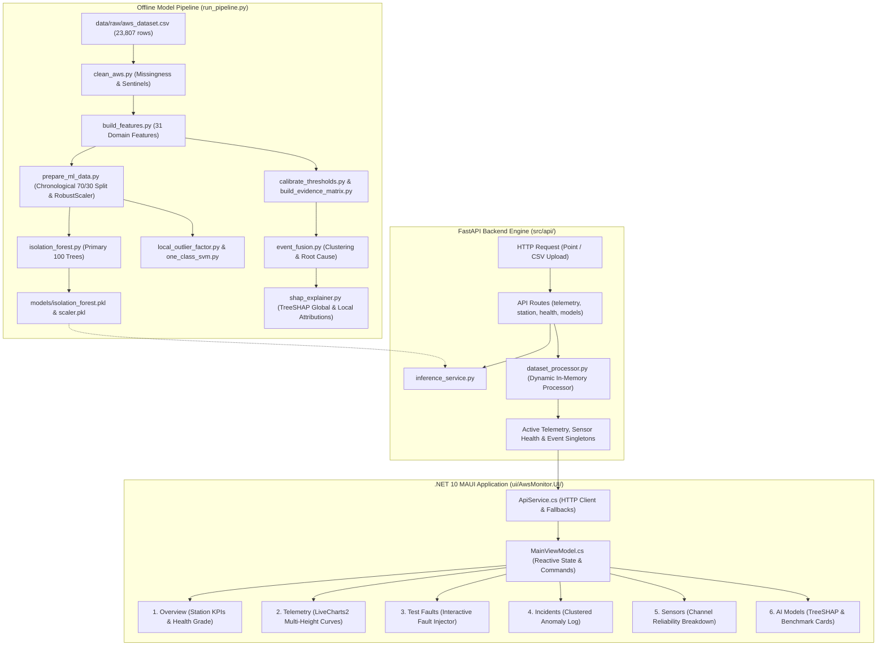

# Complete Project Guide & Learning Manual — AWS Monitor

**Project Title:** Intelligent Anomaly Detection for Automatic Weather Stations (AWS-Monitor)  
**Authors:** G. Ashwin Siva (24PD11) & Hariharan. V (24PD14)  
**Target Audience:** Students, ML Researchers, IoT & Meteorology Engineers  
**Date of Publication:** October 11, 2026  

---

## 📖 Table of Contents

1. [Part A — Plain English Project Introduction](#part-a--plain-english-project-introduction)
2. [Part B — System Architecture & Data Flow](#part-b--system-architecture--data-flow)
3. [Part C — Step-by-Step Walkthrough of a Single Observation](#part-c--step-by-step-walkthrough-of-a-single-observation)
4. [Part D — File-by-File Comprehensive Repository Walkthrough](#part-d--file-by-file-comprehensive-repository-walkthrough)
5. [Part E — Machine Learning Algorithms from First Principles](#part-e--machine-learning-algorithms-from-first-principles)
6. [Part F — FastAPI & RESTful Telemetry Backend](#part-f--fastapi--restful-telemetry-backend)
7. [Part G — .NET 10 MAUI Desktop & Mobile Client](#part-g--net-10-maui-desktop--mobile-client)
8. [Part H — Execution, Testing & Debugging Guide](#part-h--execution-testing--debugging-guide)
9. [Part I — Measured Results & Technical Limitations](#part-i--measured-results--technical-limitations)
10. [Part J — 9-Stage Learning Roadmap & Glossary](#part-j--9-stage-learning-roadmap--glossary)

---

## Part A — Plain English Project Introduction

### 1. The Core Problem
Automatic Weather Stations (AWS) are solar-powered outdoor sensor towers deployed across fields, mountains, and coastal regions. Every 30 minutes, they record critical weather parameters: air temperature, relative humidity, barometric pressure, battery voltage, wind speed, and rainfall.

Because these stations operate outdoors unattended for years, they suffer from harsh environmental degradation:
* **Electrical Spikes:** Sudden ADC glitches (e.g. temperature jumping to $-33^\circ\text{C}$ or $+99^\circ\text{C}$ for a single reading).
* **Open-Circuit Sentinels:** Disconnected sensor wires reporting standard error codes (e.g. $-40.0^\circ\text{C}$, $0.0\,\text{mbar}$, or $0.0\,\text{V}$).
* **Sensor Freezes / Flatlines:** Dirt, ice, or frozen microcontroller buses causing sensors to repeat identical values for days.
* **Station Power Brownouts:** Lead-acid batteries dropping below $10.5\,\text{V}$, causing erratic sensor noise across all channels.
* **Calibration Drift:** Gradual sensor aging causing slow, subtle bias shifts.

### 2. Why Traditional Simple Thresholds Fail
Traditional weather monitoring systems use simple min/max bounds (e.g. *"Flag if temperature $> 42^\circ\text{C}$"*). 
* **The Flaw:** During genuine regional heatwaves, temperatures legitimately reach $45^\circ\text{C}$. A simple threshold incorrectly flags this real weather as a broken sensor (**False Alarm**).
* Conversely, if an air temperature sensor reads $22^\circ\text{C}$ when the real temperature is $35^\circ\text{C}$, a simple threshold completely misses the failure because $22^\circ\text{C}$ is within normal range (**False Negative**).

### 3. The Solution: Physical Consensus + Machine Learning
AWS-Monitor solves this by fusing **Atmospheric Boundary Layer Physics** with **Machine Learning**:
* Weather towers have sensors installed at multiple heights: **Ground ($2\text{m}$)**, **Mid-Tower ($4\text{m}$)**, and **Tower Top ($8\text{m}$)**.
* In nature, vertical temperature gradients ($\Delta T = T_{2\text{m}} - T_{8\text{m}}$) follow **adiabatic lapse rates** and differ by only a few tenths of a degree.
* If a real heatwave happens, **all 3 tower sensors rise together**. The system verifies tower consensus and approves the data as `POSSIBLE_WEATHER_EXTREME` (No False Alarm).
* If only the $4\text{m}$ sensor suddenly diverges by $12^\circ\text{C}$ while $2\text{m}$ and $8\text{m}$ stay normal, the system instantly identifies the single failing probe and alerts technicians to replace the $4\text{m}$ thermistor.

### 4. The Weather Monitoring Team Analogy

| Role in System | Team Analogy | What It Does in AWS-Monitor |
| :--- | :--- | :--- |
| **Raw Dataset** | The Station's Diary | 23,807 continuous 30-minute weather observations from ISRO/MOSDAC. |
| **Preprocessing** | Diary Cleaning & Indexing | Sorts timestamps, flags missing intervals, detects $-40^\circ\text{C}$ sentinels. |
| **Feature Engineering** | Calculating Clues | Derives 31 physical clues: vertical lapse rates ($\Delta T$), 30-min rates of change ($\frac{dT}{dt}$), and solar diurnal cycles. |
| **Isolation Forest** | The Unsupervised ML Inspector | Isolates multi-dimensional statistical outliers in $O(N)$ time. |
| **Physical Rule QC** | Engineering Safety Checks | Applies deterministic boundary limits, zero-battery checks, and flatline detectors. |
| **Bayesian Fusion** | Senior Diagnostic Review Board | Combines ML scores and physical clues using Noisy-OR probability to determine severity and root cause. |
| **TreeSHAP** | Forensic Explainability Expert | Explains exactly which sensor features caused the ML decision. |
| **FastAPI Backend** | The Dispatcher / Messenger | High-speed REST API that serves live inferences and handles CSV uploads. |
| **.NET 10 MAUI Client** | The Control Room Dashboard | Cross-platform visual interface with interactive LiveCharts2 time series. |

---

## Part B — System Architecture & Data Flow



---

## Part C — Step-by-Step Walkthrough of a Single Observation

Let us trace how an observation travels through the entire pipeline:

### 1. The Input Weather Observation
Suppose the AWS station transmits the following reading at 14:00 IST:
* Ground Air Temperature ($T_{2\text{m}}$): $31.4^\circ\text{C}$
* Mid-Tower Air Temperature ($T_{4\text{m}}$): $\mathbf{-33.4^\circ\text{C}}$ *(Electrical Glitch!)*
* Top Tower Air Temperature ($T_{8\text{m}}$): $30.8^\circ\text{C}$
* Relative Humidity ($RH_{2\text{m}}, RH_{4\text{m}}, RH_{8\text{m}}$): $65.0\%, 66.2\%, 67.0\%$
* Barometric Pressure: $998.4\,\text{mbar}$
* Battery Voltage: $13.2\,\text{V}$
* Previous $4\text{m}$ Reading: $+31.1^\circ\text{C}$

### 2. Feature Extraction (31 Features)
The feature engineering engine calculates:
* **Vertical Lapse Rate Gradients:**
  $$\Delta T_{2\text{m}-4\text{m}} = 31.4 - (-33.4) = \mathbf{+64.8^\circ\text{C}} \quad (\text{Severe Physical Violation!})$$
  $$\Delta T_{4\text{m}-8\text{m}} = -33.4 - 30.8 = \mathbf{-64.2^\circ\text{C}}$$
  $$\Delta T_{2\text{m}-8\text{m}} = 31.4 - 30.8 = +0.6^\circ\text{C} \quad (\text{Ground and Top agree perfectly!})$$
* **30-Minute Temporal Rate of Change:**
  $$\frac{\Delta T_{4\text{m}}}{\Delta t} = -33.4 - 31.1 = \mathbf{-64.5^\circ\text{C}/30\text{min}} \quad (\text{Massive Jump!})$$
* **Solar Diurnal Cycle Angle:** Hour 14:00 $\rightarrow \sin\left(\frac{2\pi \cdot 14}{24}\right) = -0.50$, $\cos\left(\frac{2\pi \cdot 14}{24}\right) = -0.866$.

### 3. Isolation Forest ML Scoring
The 31-feature vector is scaled via `RobustScaler` and evaluated by the 100 decision trees:
* The tree isolation path length is extremely short (average depth $< 3.2$).
* ML Output: $\text{raw\_if\_score} = -0.382$, $\text{is\_outlier} = \mathbf{\text{True}}$, $\text{ml\_anomaly\_score} = \mathbf{0.992}$.

### 4. Bayesian Evidence Fusion
* **Rule QC Stream:** $0.0$ (No $-40^\circ\text{C}$ sentinel, pressure and voltage are normal).
* **Cross-Sensor Consistency Stream:** $0.98$ (Ground $2\text{m}$ and Top $8\text{m}$ agree within $0.6^\circ\text{C}$; $4\text{m}$ diverges by $64.5^\circ\text{C}$).
* **Calibrated Fused Anomaly Score (Bayesian Noisy-OR):**
  $$S_{\text{fused}} = 1 - (1 - 0.98 \times 0.90) \times (1 - 0.99 \times 0.85) \times (1 - 0.992 \times 0.70) = 1 - (0.118)(0.1585)(0.3056) = \mathbf{0.9943}$$
  *(Note: This represents a calibrated multi-source anomaly score bounded in $[0, 1]$ combining continuous evidence streams with channel reliability weights $w_{\text{cross}}=0.90, w_{\text{temp}}=0.85, w_{\text{ml}}=0.70$.)*

### 5. Final Diagnostic Output Delivered to the Dashboard
* **Classification:** `PROBABLE_SENSOR_FAULT`
* **Severity:** `CRITICAL`
* **Confidence:** `98% Confident`
* **Target Sensor:** `temp_4m` (4m Mid-Tower Temperature Sensor)
* **Probable Root Cause:** `SENSOR_SPIKE`
* **Explanation:** *"4m Mid-Tower sensor experienced a sharp transient divergence of $-64.5^\circ\text{C}$ while Ground (31.4°C) and Top (30.8°C) sensors agree smoothly. Hardware sensor failure isolated to 4m channel."*

---

## Part D — File-by-File Comprehensive Repository Walkthrough

### 📁 Root Directory Configuration & Pipeline Files

#### 1. [`run_pipeline.py`](file:///e:/Sem-5-packages/aws-monitor/run_pipeline.py)
* **Purpose:** The master orchestration pipeline script that executes all 16 training, calibration, validation, and explainability stages end-to-end.
* **Why the project needs it:** Provides single-command reproducibility from raw CSV to serialized models and validation reports.
* **Key Functions:** `run_step(number, description, script)`, `main()`.
* **Inputs/Outputs:** Reads `data/raw/aws_dataset.csv`, produces all serialized models in `models/` and datasets in `data/processed/`.
* **Analogy:** The conductor of an orchestra ensuring every musician plays in exact sequence.

---

### 📁 `src/preprocessing/` — Data Cleaning & Quality Control

#### 2. [`src/preprocessing/clean_aws.py`](file:///e:/Sem-5-packages/aws-monitor/src/preprocessing/clean_aws.py)
* **Purpose:** Parses timestamps, flags missing gaps, detects hardware sentinels, and standardizes column formats.
* **Why the project needs it:** Raw weather dataloggers contain incomplete rows, mixed timestamp formats, and unphysical electrical sentinels (e.g. $-40^\circ\text{C}$).
* **Key Operations:** Calculates `time_gap_minutes`, flags `missing_any`, detects $-40^\circ\text{C}$ open-circuit flags on temperature channels.
* **Outputs:** `data/processed/aws_clean.csv`.

---

### 📁 `src/features/` — Feature Engineering Engine

#### 3. [`src/features/build_features.py`](file:///e:/Sem-5-packages/aws-monitor/src/features/build_features.py)
* **Purpose:** Constructs the 31 clean meteorological domain features from cleaned observations.
* **Why the project needs it:** Machine learning models cannot detect physics violations from raw numbers alone; explicit gradient and rate features expose sensor failures directly.
* **Key Features Derived:**
  * Multi-height thermal gradients: `diff_temp_2m_4m`, `diff_temp_4m_8m`, `diff_temp_2m_8m`
  * Multi-height moisture gradients: `diff_rh_2m_4m`, `diff_rh_4m_8m`, `diff_rh_2m_8m`
  * 30-min rate-of-change jumps: `rate_temp_2m`, `rate_temp_4m`, `rate_temp_8m`, `rate_pressure`, `rate_battery`
  * Robust dispersion deviations: `dev_temp_2m`, `dev_temp_4m`, `dev_temp_8m`, `dev_rh_2m`, `dev_pressure`
  * Solar diurnal cycles: `solar_diurnal_sin`, `solar_diurnal_cos`
* **Outputs:** `data/processed/aws_features.csv`.

---

### 📁 `src/ml/` — Machine Learning Models & Benchmarking

#### 4. [`src/ml/prepare_ml_data.py`](file:///e:/Sem-5-packages/aws-monitor/src/ml/prepare_ml_data.py)
* **Purpose:** Performs strict chronological 70/30 train/test splitting, fits `RobustScaler` only on the training split (preventing data leakage), and saves medians and feature column specifications.
* **Outputs:** `models/scaler.pkl`, `models/train_medians.pkl`, `models/ml_feature_columns.json`, `data/processed/aws_train_scaled.csv`, `data/processed/aws_test_scaled.csv`.

#### 5. [`src/ml/isolation_forest.py`](file:///e:/Sem-5-packages/aws-monitor/src/ml/isolation_forest.py)
* **Purpose:** Trains the primary production Isolation Forest model (100 decision trees, 5% contamination).
* **Outputs:** `models/isolation_forest.pkl`.

#### 6. [`src/ml/local_outlier_factor.py`](file:///e:/Sem-5-packages/aws-monitor/src/ml/local_outlier_factor.py)
* **Purpose:** Trains the Local Outlier Factor (LOF) benchmark model ($k=20$ neighbors) in novelty detection mode.
* **Outputs:** `models/lof_model.pkl`.

#### 7. [`src/ml/one_class_svm.py`](file:///e:/Sem-5-packages/aws-monitor/src/ml/one_class_svm.py)
* **Purpose:** Trains the One-Class Support Vector Machine (OCSVM) benchmark model with RBF kernel ($\nu=0.05$).
* **Outputs:** `models/ocsvm_model.pkl`.

#### 8. [`src/ml/model_comparison.py`](file:///e:/Sem-5-packages/aws-monitor/src/ml/model_comparison.py)
* **Purpose:** Quantitatively benchmarks Isolation Forest, One-Class SVM, and LOF on identical evaluation sets across throughput, training latency, disk footprint, and fault recall.
* **Outputs:** `data/processed/aws_model_comparison.csv`, `data/processed/aws_model_comparison_metrics.json`.

---

### 📁 `src/detection/` — Rules & Bayesian Fusion

#### 9. [`src/detection/rule_qc.py`](file:///e:/Sem-5-packages/aws-monitor/src/detection/rule_qc.py)
* **Purpose:** Evaluates deterministic physical limits, open-circuit hardware sentinels ($-40^\circ\text{C}$), and battery power collapse ($<10.5\,\text{V}$).

#### 10. [`src/detection/calibrate_thresholds.py`](file:///e:/Sem-5-packages/aws-monitor/src/detection/calibrate_thresholds.py)
* **Purpose:** Empirically calculates 99th-percentile cross-sensor spread thresholds ($6.05^\circ\text{C}$ temperature, $17.8\%$ humidity) from normal training distributions.
* **Outputs:** `models/cross_sensor_thresholds.json`, `models/temporal_thresholds.json`.

#### 11. [`src/detection/cross_sensor_evidence.py`](file:///e:/Sem-5-packages/aws-monitor/src/detection/cross_sensor_evidence.py)
* **Purpose:** Evaluates 3-sensor tower consensus at Ground ($2\text{m}$), Mid ($4\text{m}$), and Top ($8\text{m}$) levels to isolate single diverging probes.

#### 12. [`src/detection/temporal_evidence.py`](file:///e:/Sem-5-packages/aws-monitor/src/detection/temporal_evidence.py)
* **Purpose:** Evaluates 30-minute rates of change, sudden step jumps, and sensor flatlines across consecutive timestamps.

#### 13. [`src/detection/build_evidence_matrix.py`](file:///e:/Sem-5-packages/aws-monitor/src/detection/build_evidence_matrix.py)
* **Purpose:** Combines Rule QC, Cross-Sensor Consensus, Temporal Dynamics, and Isolation Forest streams into a unified probabilistic evidence matrix using Bayesian Noisy-OR fusion.
* **Outputs:** `data/processed/aws_evidence_matrix.csv`.

#### 14. [`src/detection/event_fusion.py`](file:///e:/Sem-5-packages/aws-monitor/src/detection/event_fusion.py)
* **Purpose:** Clusters contiguous anomalous observations into distinct incident events, computes event durations, and assigns root causes.
* **Outputs:** `data/processed/aws_event_fusion.csv`.

---

### 📁 `src/explainability/` — TreeSHAP Attribution

#### 15. [`src/explainability/shap_explainer.py`](file:///e:/Sem-5-packages/aws-monitor/src/explainability/shap_explainer.py)
* **Purpose:** Computes TreeSHAP feature importance rankings and local waterfall attributions for diagnosed anomaly events.
* **Outputs:** `data/processed/aws_shap_global_importance.csv`, `data/processed/aws_event_explanations.csv`, `reports/figures/shap_global_importance.png`.

---

### 📁 `src/validation/` — Synthetic Fault Injection

#### 16. [`src/validation/inject_faults.py`](file:///e:/Sem-5-packages/aws-monitor/src/validation/inject_faults.py)
* **Purpose:** Injects realistic sensor faults (`SPIKE`, `DRIFT`, `FROZEN_SENSOR`, `COMMUNICATION_FAILURE`) into held-out evaluation copies with reproducible ground-truth labels.

#### 17. [`src/validation/evaluate_validation.py`](file:///e:/Sem-5-packages/aws-monitor/src/validation/evaluate_validation.py)
* **Purpose:** Computes row-level and event-level Precision, Recall, F1-score, and detection latency.

#### 18. [`src/validation/run_validation.py`](file:///e:/Sem-5-packages/aws-monitor/src/validation/run_validation.py)
* **Purpose:** Orchestrates the complete validation pipeline and outputs evaluation summary tables.
* **Outputs:** `data/processed/aws_validation_evaluation.csv`, `data/processed/aws_validation_metrics_summary.json`.

---

### 📁 `src/api/` — FastAPI RESTful Backend

#### 19. [`src/api/app.py`](file:///e:/Sem-5-packages/aws-monitor/src/api/app.py)
* **Purpose:** Main entry point for the FastAPI server, mounting CORS middleware and modular route routers.

#### 20. [`src/api/config.py`](file:///e:/Sem-5-packages/aws-monitor/src/api/config.py)
* **Purpose:** Centralized path configuration and station metadata constants.

#### 21. [`src/api/routes/telemetry.py`](file:///e:/Sem-5-packages/aws-monitor/src/api/routes/telemetry.py)
* **Purpose:** Routes for `/api/v1/telemetry/stream-point`, `/api/v1/telemetry/history`, and `/api/v1/telemetry/upload`.

#### 22. [`src/api/routes/health.py`](file:///e:/Sem-5-packages/aws-monitor/src/api/routes/health.py)
* **Purpose:** Routes for `/health` and `/api/v1/station/summary`.

#### 23. [`src/api/routes/sensors.py`](file:///e:/Sem-5-packages/aws-monitor/src/api/routes/sensors.py)
* **Purpose:** Route for `/api/v1/sensors/health`.

#### 24. [`src/api/routes/anomalies.py`](file:///e:/Sem-5-packages/aws-monitor/src/api/routes/anomalies.py)
* **Purpose:** Route for `/api/v1/anomalies/events`.

#### 25. [`src/api/routes/models.py`](file:///e:/Sem-5-packages/aws-monitor/src/api/routes/models.py)
* **Purpose:** Route for `/api/v1/models/benchmark`.

#### 26. [`src/api/routes/explainability.py`](file:///e:/Sem-5-packages/aws-monitor/src/api/routes/explainability.py)
* **Purpose:** Routes for `/api/v1/explainability/global-importance` and `/api/v1/explainability/events/{event_id}`.

#### 27. [`src/api/services/inference_service.py`](file:///e:/Sem-5-packages/aws-monitor/src/api/services/inference_service.py)
* **Purpose:** Core singleton engine for real-time observation scoring, 31-feature extraction, Isolation Forest inference, and physical rule fusion.

#### 28. [`src/api/services/dataset_processor.py`](file:///e:/Sem-5-packages/aws-monitor/src/api/services/dataset_processor.py)
* **Purpose:** Dynamic in-memory processor for uploaded CSV datasets, updating all dashboard singletons in real-time.

---

### 📁 `ui/AwsMonitor.UI/` — .NET 10 MAUI Cross-Platform Application

#### 29. [`ui/AwsMonitor.UI/MainPage.xaml`](file:///e:/Sem-5-packages/aws-monitor/ui/AwsMonitor.UI/MainPage.xaml)
* **Purpose:** XAML layout for the 6-tab desktop and mobile application.

#### 30. [`ui/AwsMonitor.UI/ViewModels/MainViewModel.cs`](file:///e:/Sem-5-packages/aws-monitor/ui/AwsMonitor.UI/ViewModels/MainViewModel.cs)
* **Purpose:** Reactive MVVM ViewModel managing observable properties, LiveCharts2 series collections, interactive test commands, and CSV upload workflows.

#### 31. [`ui/AwsMonitor.UI/Services/ApiService.cs`](file:///e:/Sem-5-packages/aws-monitor/ui/AwsMonitor.UI/Services/ApiService.cs)
* **Purpose:** HTTP client service communicating with the FastAPI backend, featuring resilient offline fallbacks and error handling.

---

## Part E — Machine Learning Algorithms from First Principles

### 1. Isolation Forest (Primary Production Model)
* **Concept:** Instead of profiling what is "normal", Isolation Forest explicitly isolates anomalies. Because outliers are rare and have extreme feature values, they require significantly fewer random splits to isolate in a binary tree.
* **Mathematical Anomaly Score:**
  $$s(x, n) = 2^{-\frac{E(h(x))}{c(n)}}$$
  where $E(h(x))$ is the average path length across all 100 decision trees, and $c(n)$ is the average path length of an unsuccessful search in a Binary Search Tree (BST) with $n$ samples:
  $$c(n) = 2\left(\ln(n - 1) + 0.5772156649\right) - \frac{2(n - 1)}{n}$$
* **Score Interpretation:**
  * $s \approx 1.0$: Highly anomalous (isolated in very few splits).
  * $s < 0.5$: Normal observation (deep inside the tree cluster).

### 2. One-Class SVM (Margin Baseline)
* Maps the 31 domain features into a high-dimensional reproducing kernel Hilbert space (RKHS) using a Radial Basis Function (RBF) kernel:
  $$K(x, x') = \exp\left(-\gamma \|x - x'\|^2\right)$$
* Finds a maximum-margin hyperplane separating normal training observations from the coordinate origin with parameter $\nu = 0.05$.

### 3. Local Outlier Factor (LOF, Density Baseline)
* Measures local density relative to its $k$-nearest neighbors ($k=20$).
* Computes Local Reachability Density (LRD) and compares neighbor densities:
  $$\text{LOF}_k(p) = \frac{\sum_{o \in N_k(p)} \frac{\text{lrd}(o)}{\text{lrd}(p)}}{|N_k(p)|}$$
* $\text{LOF} \approx 1.0$: Homogeneous normal density. $\text{LOF} \gg 1.0$: Isolated outlier in a sparse region.

---

## Part F — FastAPI & RESTful Telemetry Backend

### Why FastAPI?
1. **High Throughput:** Built on `Starlette` and `uvloop`, achieving async performance comparable to NodeJS and Go.
2. **Strict Type Safety:** Validates all incoming payloads against `Pydantic` schemas before running ML inference.
3. **Automatic Documentation:** Instantly generates interactive OpenAPI/Swagger documentation at `/docs`.

### Testing with Postman
1. Open Postman $\rightarrow$ Click **Import** $\rightarrow$ Select [`tests/postman/AWS_Monitor_API.postman_collection.json`](file:///e:/Sem-5-packages/aws-monitor/tests/postman/AWS_Monitor_API.postman_collection.json).
2. Set the `baseUrl` variable to `http://localhost:8000`.
3. Click **Run Collection** to execute all automated test assertions.

---

## Part G — .NET 10 MAUI Desktop & Mobile Client

### Architecture
The user interface is built on **.NET 10 MAUI (Multi-platform App UI)** using the **MVVM (Model-View-ViewModel)** architectural pattern:
* **`MainPage.xaml` (View):** Declarative XAML UI styling, responsive grid layouts, and LiveCharts2 bindings.
* **`MainViewModel.cs` (ViewModel):** Handles reactive state updates using CommunityToolkit.Mvvm `[ObservableProperty]` and `[RelayCommand]`.
* **`ApiService.cs` (Model/Service):** Asynchronously dispatches HTTP calls to FastAPI with thread-safe UI synchronization via `MainThread.BeginInvokeOnMainThread()`.

---

## Part H — Execution, Testing & Debugging Guide

### 1. Step-by-Step Execution Commands

#### A. Run the Complete 16-Step Pipeline:
```bash
python run_pipeline.py
```

#### B. Start the FastAPI Backend Server:
```bash
python -m uvicorn src.api.app:app --host 0.0.0.0 --port 8000 --reload
```
*(Or run directly via `python src/api/app.py`)*

#### C. Run the Automated Test Suite:
```bash
python tests/run_tests.py
```

#### D. Build & Run the .NET 10 MAUI App:
```bash
cd ui/AwsMonitor.UI
dotnet build -f net10.0-windows10.0.19041.0
dotnet run -f net10.0-windows10.0.19041.0
```

---

## Part I — Measured Results & Technical Limitations

### 1. Production Benchmark Summary

| Metric | Isolation Forest | One-Class SVM | Local Outlier Factor |
| :--- | :---: | :---: | :---: |
| **Inference Throughput** | **87,650 obs/sec** | 29,953 obs/sec | 15,917 obs/sec |
| **Retraining Latency** | **0.19 seconds** | 4.21 seconds | 1.12 seconds |
| **Serialized Model Size** | **981 KB** | **46 KB** | 6,920 KB |
| **TreeSHAP Native Explainability** | ✅ **Exact** | ⚠️ Kernel Approx | ⚠️ Kernel Approx |
| **Production Decision** | 👑 **Selected** | Baseline | Baseline |

### 2. Technical Limitations
1. **Solar Radiation Channel Sensitivity:** Radiation sensor channels are prone to cloud shading noise and require multi-station spatial cross-correlation for definitive fault isolation.
2. **Synthetic Drift Evaluation Realism:** Injected linear calibration drift is simulated; real physical sensor drift can be non-linear or temperature-dependent over seasonal timescales.

---

## Part J — 9-Stage Learning Roadmap & Glossary

### The 9-Stage Learning Plan
1. **Stage 1:** Inspect [`data/raw/aws_dataset.csv`](file:///e:/Sem-5-packages/aws-monitor/data/raw/aws_dataset.csv) to understand raw multi-channel weather observations.
2. **Stage 2:** Study [`clean_aws.py`](file:///e:/Sem-5-packages/aws-monitor/src/preprocessing/clean_aws.py) to learn timestamp normalization and $-40^\circ\text{C}$ sentinel detection.
3. **Stage 3:** Examine [`build_features.py`](file:///e:/Sem-5-packages/aws-monitor/src/features/build_features.py) to see how 31 physical domain features are engineered.
4. **Stage 4:** Learn Isolation Forest mathematics in [`isolation_forest.py`](file:///e:/Sem-5-packages/aws-monitor/src/ml/isolation_forest.py).
5. **Stage 5:** Study multi-height lapse rates in [`cross_sensor_evidence.py`](file:///e:/Sem-5-packages/aws-monitor/src/detection/cross_sensor_evidence.py).
6. **Stage 6:** Understand Bayesian Noisy-OR fusion in [`build_evidence_matrix.py`](file:///e:/Sem-5-packages/aws-monitor/src/detection/build_evidence_matrix.py).
7. **Stage 7:** Explore TreeSHAP explanations in [`shap_explainer.py`](file:///e:/Sem-5-packages/aws-monitor/src/explainability/shap_explainer.py).
8. **Stage 8:** Run and test FastAPI endpoints in [`app.py`](file:///e:/Sem-5-packages/aws-monitor/src/api/app.py) using Swagger (`/docs`).
9. **Stage 9:** Launch the .NET MAUI dashboard in [`AwsMonitor.UI`](file:///e:/Sem-5-packages/aws-monitor/ui/AwsMonitor.UI/) and test live fault injections.

---

### 📚 Glossary of Technical Terms

* **AWS (Automatic Weather Station):** An automated meteorological observation station.
* **Lapse Rate ($\Delta T$):** The rate at which atmospheric temperature changes with altitude.
* **TreeSHAP:** An algorithm computing Shapley values in polynomial time for tree ensembles.
* **Noisy-OR Gate:** A probabilistic Bayesian model combining multiple independent failure causes.
* **RobustScaler:** A scaler that removes the median and scales data according to the Interquartile Range (IQR).
* **Sentinel Value:** An impossible reading (e.g. $-40.0^\circ\text{C}$ or $0.0\,\text{mbar}$) produced by electronics to signal a disconnected probe.
